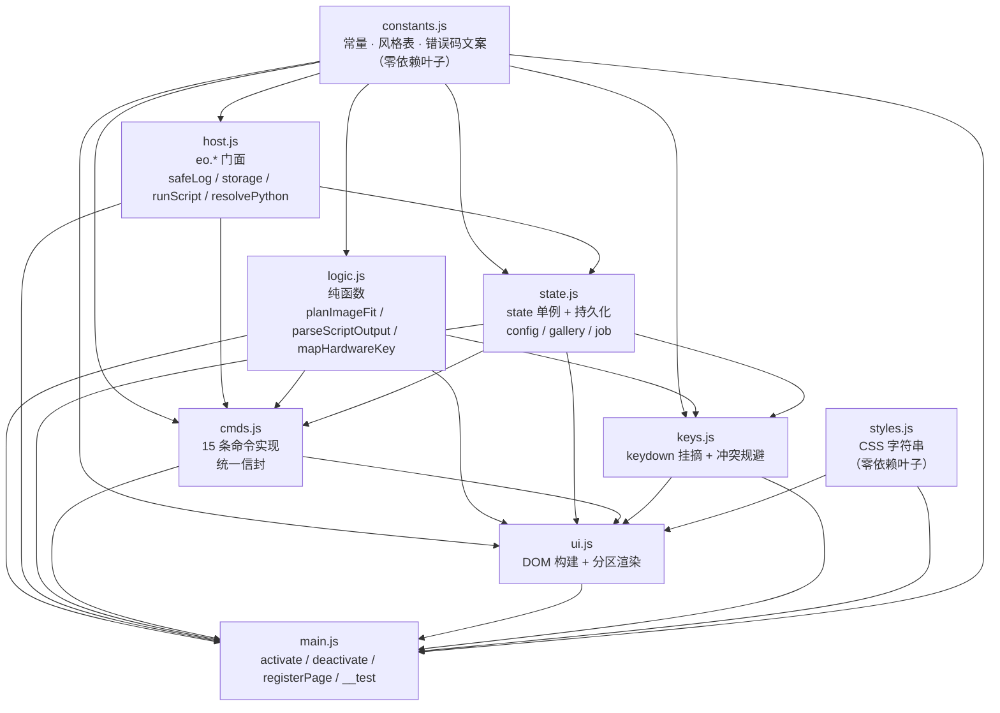

# StyleCam 风格调色盘 —— 系统设计 + 任务分解

| 项 | 值 |
| --- | --- |
| 文档类型 | 架构设计（工程视角） |
| 作者 | 高见远（架构师） |
| 日期 | 2026-09-25 |
| 宿主版本 | easyop v0.38.0 |
| 形态 | 内置插件，侧栏页签 `stylecam.board` |
| 上游 | `C:\Users\86136\.workbuddy\plans\swift-cascade-darwin-xVJ6cmaJ.md`（已批准实施计划）<br>`plugins/builtin/stylecam/PRD.md`（许清楚，增量 PRD） |
| 下游 | 工程师 寇豆码（按第 7 节任务列表执行）、QA 严过关（按第 7 节验收标准验收） |
| 本文覆盖 | 模块划分、数据结构、时序、任务分解、跨文件约定 |
| 本文不覆盖 | 用户看到什么文案（以 PRD 为准）、错误文案措辞（逐字抄 PRD 5.2） |

**证据规则**：本文每条涉及宿主行为的结论都标 `文件:行号`。**文档与源码冲突时以源码为准**——第 2.1 节列出本次核出的 9 处偏离，工程师按「源码结论」列执行，不要按计划/PRD 原文执行。

---

## 0. 配置 v2 最终设计（插件 0.5.0）

本节覆盖 2026-09-28 落地的集中配置能力；与后文配置 v1、固定 2K、15 命令或 3 tools 的旧描述冲突时，以本节和当前源码为准。当前清单为 **21 条命令、6 条 tools、1 个页签**。

### 0.1 配置模型与优先级

`stylecam.config` 升级为 `v:2`，生图配置字段为：

```js
{
  v: 2,
  provider: 'easysu',
  baseUrl: '',
  model: '',
  resolution: '1K',
  width: 1024,
  height: 1024,
  format: 'auto',
  quality: null,
  n: 1,
  httpTimeoutSecs: 120,
  retryCount: 1,
  outDir: ''
}
```

最终合并顺序为 `provider 默认值 < tools/stylecam_io.env < stylecam.config < job/命令单次覆盖 < CLI`。实现上，持久化配置中已出现的字段会压过 `.env`；job 和 CLI 只覆盖非空字段。旧 `size` 自动迁移：等级串映射到 `resolution`，`<宽>x<高>` 映射到 `width/height`，新字段优先。迁移时必须删除 `apiKey`、`IMAGE_API_KEY`、`ARK_API_KEY`。

### 0.2 校验与 provider 能力矩阵

通用范围：`resolution ∈ {1K,2K,4K}`；宽高各 256–4096、64 的倍数且面积不超过 16,777,216；`format ∈ {auto,jpeg,png}`；`quality=null|1..100`；`n=1..4`；HTTP 超时 10–240 秒；重试 0–3；`baseUrl` 最长 2048 且必须 HTTPS（仅本机地址可 HTTP）；`model` 最长 256；`outDir` 最长 2048。

| provider | 尺寸映射 | format | quality | 最大 n | 图生图 |
| --- | --- | --- | --- | --- | --- |
| EasySU | `resolution` + 最近比例；仅接受 `1:1/16:9/9:16/4:3/3:4`，相对误差 ≤3% | auto/jpeg/png | 支持，且仅 jpeg | 4 | `/images/edits` JSON base64 |
| Ark | 仅方形；payload `size=resolution` | auto/jpeg/png | 不支持 | 1 | `image` 数组 |
| OpenAI-compatible | payload `size=<width>x<height>` | `gpt-image-*` 可 auto/jpeg/png；`dall-e-3` 或其它模型仅 auto | 仅 `gpt-image-*` 支持 | 4 或受限模型 1 | 当前退化为文生图 |
| 智谱 | payload `size=<width>x<height>` | 仅 auto | 不支持 | 1 | 当前退化为文生图 |

Python `validate_config`、`validate_capabilities`、`map_dimensions` 是执行前最终安全网。QA 发现前端 `validateConfig/configFailure` 尚未完全复刻 Python 的 URL/长度和 capability matrix 校验，因此前端本地 `config.validate/set` 可能先接受、到 Python 执行时再明确拒绝；该差异路由给 Engineer，不在 QA 允许范围内修改源码。

### 0.3 动态超时与重试

前端根据 `(retryCount + 1) × httpTimeoutSecs`、URL 下载余量、指数退避余量和 30 秒启动/解析/落盘余量计算 `eo.run` timeout，最终夹在 60–1260 秒，并继续双写 `timeout_secs` / `timeoutSecs`。

脚本只重试 408、425、429、500、502、503、504 和可确认发生在发送前的连接失败；遵循 `Retry-After`（最大 30 秒），否则指数退避加轻微抖动。POST 已发送后的读超时、socket timeout 或不确定连接中断不重试，避免重复生成与重复计费。400、401、403、404、405、409、413、422 等直接返回。

### 0.4 Key 临时 secret 通道

API Key 不属于配置模型，不允许进入 `stylecam.config`、`stylecam.job`、`eo.run args`、日志或命令信封。UI 通过 `stylecam.secret={nonce,value,createdAt}` 暂存；子进程参数只携带 storage key 和 nonce。Python `consume_storage_secret` 在验证 nonce/有效期之前先把 secret 原子置 `null`，随后用临时文件 + `os.replace()` 更新 `.env`；前端 `finally` 再清理一次。设置页 password 输入不预填，保存调用结束后无论结果都清空。

### 0.5 UI 与命令面

设置浮层包含「图像参数」「API 配置」两个分区，暴露 12 个非敏感字段和单独 API Key 密码框。新增命令：`config.get/set/validate/reset`、`provider.list`、`key.status/set`；tools 从 3 条扩为 6 条，新增脱敏配置读取、provider 能力列表和 Key 状态。UI 目前只对 `quality` 做 provider 联动，尚未完整禁用不支持的 `format/n`；“自检连接”按钮当前调用 `probe:false`，不执行联网探测。两项均路由 Engineer。

### 0.6 QA 证据与限制

- Node harness 274/274；clamp 29/29；Python unittest 18/18。
- 安全断言覆盖 generate args 无 Key、迁移清除 Key、secret 清理、原子 env 更新、Key status 脱敏。
- 配置断言覆盖边界、provider payload、3% 比例映射、动态 timeout、重试状态矩阵和 POST 幂等保护。
- UI 断言覆盖两分区、12 字段、空 password、控件防溢出、浅色主题和无 fixed。
- 2026-09-28 的 QA 环境没有可用浏览器，未生成截图；DOM/CSS 断言不能替代最终 WebView2 目视验证。

---

## 0.7 2026-09-28 UI 增量重构

主页面从顺序七分区调整为明亮创作工作台，业务状态机与配置协议不变：

```text
顶部工具栏
└─ 素材架 .sc-material-shelf
   └─ 创作机器 .sc-creation-stage + 强度控制 .sc-strength-dial
      └─ 作品带 .sc-gallery-strip
```

创作机器内部继续复用原 `styles/generate/result/creative` 渲染职责，但空间上合并为同一个舞台：当前风格标题与状态语义位于舞台顶部，主体素材位于大预览区，10 种风格位于横向轨道，生成中状态与失败反馈在舞台内显示，结果以 `sc-output` 动画从预览下沿出片。强度区保留真实 `input[type=range]` 作为可访问输入和原键盘/旋钮命令入口，视觉层增加环形百分比与固定刻度。

四个主区域均使用 `sc-` 前缀和 `data-role` 语义锚点。设置 overlay 仍包含配置 v2 全字段及安全 Key 操作，只将入口移动到右上工具按钮。响应式断点为 900px（强度区落到舞台下方）和 640px（单列）；主容器禁止横向溢出，素材、风格、作品轨道局部横滚。所有新增动效在 `prefers-reduced-motion: reduce` 下关闭。

---

## 1. 实现方案与选型结论

**一句话方案**：
> 一个**单文件 ESM 入口**（`index.js`，由 `src/` 下 8 个业务模块经 esbuild 打包而成）在 easyop 侧栏页签里跑完整条「素材 → 风格 → 强度 → 生图 → 结果 → 创意显示 → 作品集」链路；所有落盘与网络行为全部下放到插件自带的**纯标准库 Python 脚本**，经 `eo.run` 单向调用；图片以 `storage.json` 中转进脚本、以 stdout 分块 base64 回前端、以 `data:` URL 渲染。

### 1.1 选型确认/推翻表

| 项 | 计划的结论 | 本次裁定 | 依据 |
| --- | --- | --- | --- |
| 多文件 `src/` + esbuild 打包 | 必需 | **确认** | 入口经 `blob:` 动态 import，必须自包含单文件 ESM，不能相对 import（`src/pluginHost.ts:171-173`）；esbuild v0.21.5 实测可用（`node_modules/@esbuild/win32-x64/esbuild.exe --version` → `0.21.5`） |
| 不用 React / JSX | 必需 | **确认** | 同一处：宿主只 `import(url)`，不提供 React 运行时 |
| Python 纯标准库（`urllib`） | 必需 | **确认** | 本机 `python -V` → 3.13.14；第三方库不可假设。但由此产生一处**计划必须改**，见 2.1 偏离 #1（THUMB 改由前端产出） |
| 生图服务商 = 火山方舟，Key 走 `config.json.llm_api_key` | 必需 | **确认** | 实测 `%APPDATA%\com.easyop.app\config.json`：`llm_api_key` 长度 46、前缀 `ark-`；`llm_endpoint=https://ark.cn-beijing.volces.com/api/plan/v3/chat/completions`；`llm_model=doubao-seed-2.0-mini` |
| 生图端点 | `POST https://ark.cn-beijing.volces.com/api/v3/images/generations` | **确认，且必须写死常量** | **不能**由 `llm_endpoint` 字符串推导——它走的是 `/api/plan/` 网关，替换路径会拼错。见 2.1 偏离 #2 |
| `response_format=b64_json`、`size="2K"`、`watermark:false` | 计划已定 | **确认** | 主理人已核实，不再复查 |
| `output_format` | 计划定 `png` | **推翻 → 默认 `jpeg`** | 2K PNG 实测量级 3–6MB，base64 后 4–8MB 要穿过 Tauri IPC（`runner.rs:374` 把 stdout 全文 join 成一个 String 回传）；2K JPEG 约 0.5–1.2MB。PRD 元信息行示例写「278KB」，与 JPEG 量级一致 |
| 风格样片用 CSS 色板占位 | 计划已定 | **确认** | `plugin_host.rs:44` 是 `fs::read_to_string` 全量读入再 emit，入口越大激活越慢 |
| `__TAURI_INTERNALS__` 后门 | 不用 | **确认不用** | `withGlobalTauri:true` + `csp:null`（`src-tauri/tauri.conf.json:24,26`）确实敞开，但 easyop 未注册任何 fs/http 命令，走后门绕过插件契约、未来必断 |
| 不改 `src/` 与 `src-tauri/` | 计划已定 | **确认** | 唯一例外是 `scripts/deploy-plugins.mjs` 与 `package.json`（计划第 10 节已列，非宿主主体） |

---

## 2. 源码核对结论

### 2.1 计划 / PRD 偏离源码的 9 处（**按「源码结论」列执行**）

| # | 出处 | 文档原文 | 源码事实 | 源码结论（照此做） |
| --- | --- | --- | --- | --- |
| 1 | 计划 §三.B | 脚本 stdout 含 `THUMB=<320px JPEG base64>` | 脚本是**纯标准库**，无 PIL，无法解码/缩放 JPEG | **THUMB 改由前端产出**：前端拿到 `data:` URL 后用 canvas 生成 320px/q0.82 的 JPEG b64 再写进 gallery。脚本只吐原图分块 + `PATH` + `META` |
| 2 | 计划 §7.1 | 端点由方舟文档给出 | `config.json.llm_endpoint` 是 `/api/plan/v3/chat/completions`（**plan 网关**，非 `/api/v3/`） | 生图端点在脚本里**写死常量** `https://ark.cn-beijing.volces.com/api/v3/images/generations`，**不做字符串推导** |
| 3 | 计划 §7.1 | `output_format: png` | 见 1.1：PNG 体积经不起 IPC | 默认 `jpeg`；`--format png` 保留但 doctor 提示传输慢；落盘扩展名**按响应实际字节嗅探**（`\x89PNG` / `\xFF\xD8\xFF`），不硬编码 |
| 4 | 计划 §十一.10 | studio 里 **12 处** `timeoutSecs` 无效 | 实测 `grep -c` = **8 处**（`plugins/builtin/studio/index.js:777,852,868,882,899,916,1004,1012`），`timeout_secs` 0 处 | 数字修正为 8；**本插件一律写 `timeout_secs`**（`plugin_host.rs:196-201` 字段名是 `timeout_secs` 且无 `rename_all`，`timeoutSecs` 被 serde 静默忽略） |
| 5 | 计划 §十 | 「`plugins/README.md` 目录表加一行」 | `plugins/` 下**没有 README.md**（只有 `builtin/` 与 3 张 png） | P7 任务改为**新建** `plugins/README.md`，不是改 |
| 6 | 计划 §一.2 | 「`panels`/`keyActions`/`contextActions` 被 serde 丢弃」 | `PluginManifest` / `Contributes` **根本没有这三个字段**（`plugin_registry.rs:88-125`），不是丢弃而是未定义 | 措辞偏差、结论不变：UI 只能走 `contributes.pages` |
| 7 | PRD §3.3 A5 + 计划 | `gallery.list` 返回一句话摘要，⌘SS 里能给反馈 | `ss_execute` 对 `kind=="plugin"` 只调 `plugin_host::activate` 就 `return Ok(())`（`lib.rs:555-562`）；`pluginHost.ts:229-243` 只 catch 错误、不消费返回值；`public/ss_palette.html:1561-1570` 成功后直接 `hidePalette()` | **⌘SS 里看不到任何返回值**。三条 tools 命令必须**同时** `eo.log.info(摘要)`（日志面板能看），返回值仍按信封带 `message`，但别指望它显示 |
| 8 | 计划 §五 骨架 / 契约 P1 | `dispose` 必定摘 keydown | `PluginPageContainer.tsx:14-28` 用 async IIFE 拿 `lifecycle`；**若激活未完成时卸载，`lifecycle` 仍为 null，dispose 永不执行**，DOM 与 window keydown 都留在那 | keydown 处理函数**首行自愈**：`if (!view.root.isConnected) { detachHwKeys(view); return; }`。不依赖宿主一定调 dispose |
| 9 | PRD §2.1（Ctrl+V 贴图） | 「按 Ctrl+V 粘贴剪贴板里的图」 | `eo.clipboard_read` 只返回 **String 文本**（`plugin_host.rs:91-95` → `clipboard_util::read_clipboard`），拿不到图片 | 剪贴板图片只能走 **DOM `paste` 事件**读 `e.clipboardData.items`；`eo.clipboard_read` 不参与图片链路。粘贴非图片时走 `CLIPBOARD_NO_IMAGE` |

### 2.2 已核实并**采纳**的宿主事实（写死在常量里，别再查）

| 事实 | 证据 |
| --- | --- |
| `eo.*` 只有 8 个能力：selection / clipboard_read / replace_selection / inject / storage / log / chat / run | `src/pluginHost.ts:124-152` |
| `eo.run` 的 opts 只认 `timeout_secs` 与 `cwd` | `src-tauri/src/plugin_host.rs:196-201` |
| `eo.run` 返回 `{exit_code, stdout, stderr, timed_out, cancelled}` | `src-tauri/src/runner.rs:142-151`；stdout 是**全文拼接**（`:374`） |
| 插件存储 = `<plugins_root>/<plugin_id>/storage.json` | `src-tauri/src/plugin_host.rs:228-231` |
| `storage.set(key, null)` **不删 key，写 JSON `null`**；`storage.get` 缺失返回 `null` | `src-tauri/src/plugin_host.rs:127,150` |
| `tools` 为空 = 命令不进 ⌘SS 搜索 | `src-tauri/src/plugin_registry.rs:415-422`，单测钉死 `:617-649` |
| `tools[]` 可带 `subtitle` + `keywords`，两者都进搜索 haystack | `src-tauri/src/plugin_registry.rs:424-431`, `52-61` |
| `contributes.pages[].icon` **不被消费**，侧栏只渲染 `title` | `src/components/Sidebar.tsx:49-59`（`plugin_pages` 仍然传 icon，`lib.rs:459-471`） |
| 宿主**只调** `lifecycle.dispose()`，`refresh()` 由插件自己调 | `src/components/PluginPageContainer.tsx:21-27` |
| 宿主容器 `.plugin-page-container{flex:1;min-height:0;overflow-y:auto}` | `src/styles.css:3495-3499` |
| 页签契约 P1 同步返回 / P2 禁 `position:fixed` / P3 不动容器 / P4 样式只作用本插件 class | `docs/路径A-插件页签接口契约.md:113-116` |
| `validate()` 不校验命名空间唯一性、不校验 page id 与 command id 是否重名 | `src-tauri/src/plugin_registry.rs:270-301` |
| `activationEvents` 只被 `activation_events()` 读出，无人消费（发不激活与它无关） | `src-tauri/src/plugin_registry.rs:384-394` |
| 清单上限 256KB | `src-tauri/src/plugin_registry.rs:29` |
| `deploy-plugins.mjs:64` 的 `EXCLUDE` 缺 `"src"`；filter 只比路径最后一段 | `scripts/deploy-plugins.mjs:64,70` |
| `package.json:19` 的 `plugins:test` 只跑 studio | `package.json:19` |
| 侧栏 tabId 形如 `plugin:<pluginId>:<pageId>`，与 command id 不同命名空间 | `src/App.tsx:655`, `src/components/Sidebar.tsx:50` |

---

## 3. 文件清单

根目录 = `plugins/builtin/stylecam/`

| # | 相对路径 | 预估行数 | 职责一句话 |
| --- | --- | --- | --- |
| 1 | `plugin.json` | ~170 | 清单：15 条命令 + 3 条 tools + 1 个页签 + capabilities + activationEvents |
| 2 | `src/constants.js` | ~260 | 10 组风格定义、6 种创意显示、限流阈值、storage key、错误码 `CODE` 表（文案逐字来自 PRD 5.2）、阶段枚举、强度档位名 |
| 3 | `src/logic.js` | ~240 | **全部纯函数**：图片档位规划、强度夹取与档位名、硬件键映射、脚本输出解析、prompt 组装、摘要句生成、色板量化 |
| 4 | `src/host.js` | ~120 | `eo.*` 门面：安全日志、storage 读写、脚本调用、Python 解释器探测与缓存。**不含任何业务逻辑** |
| 5 | `src/state.js` | ~220 | 内存 `state` 单例 + config / gallery / job 三个 key 的持久化 + 变更订阅 |
| 6 | `src/cmds.js` | ~520 | 15 条命令的实现，一律返回统一信封；可在**无 DOM**环境下跑通 |
| 7 | `src/ui.js` | ~700 | DOM 构建、事件绑定、分区渲染（素材/风格/强度/生成/结果/创意/作品集）、浮层（隐私告知、硬件键说明、放大、设置） |
| 8 | `src/keys.js` | ~180 | window keydown 挂载/摘除、冲突四道规避、`isTypingTarget`、60ms 旋转节流、自愈摘除 |
| 9 | `src/styles.js` | ~420 | 导出 CSS 字符串：`--sc-*` 变量 + dark/light 双主题 + **不含 `position:fixed`** |
| 10 | `src/main.js` | ~130 | `activate` / `deactivate` / `registerPage` / 命令注册 / `__test` 测试缝 |
| 11 | `index.js` | ~2500–3000 | **打包产物，禁止手改**。由 `npm run plugins:build:stylecam` 生成 |
| 12 | `tools/stylecam_io.py` | ~520 | 纯标准库脚本：`doctor` / `generate` / `save` / `dir` / `key` 五个子命令 |
| 13 | `tools/stylecam_io.env.example` | ~14 | 环境变量模板，**不含真 Key** |
| 14 | `test/harness.mjs` | ~700 | Node 零依赖验证台：桩 `eo.*` + 极简 DOM 桩 + 14 组断言 |
| 15 | `README.md` | ~240 | 数据流、脚本契约、已否决方案存档（含 `__TAURI_INTERNALS__`、file://、真样片、自动淘汰） |

**既有文件改动（宿主主体零改动）**

| 文件 | 改动 | 必需性 |
| --- | --- | --- |
| `package.json` | 加 `plugins:build:stylecam`（esbuild）；`plugins:test` 改为串行跑 studio + stylecam | **必需** |
| `scripts/deploy-plugins.mjs:64` | `EXCLUDE` 加 `"src"` | **必需**（否则 `src/` 被拷进运行目录） |
| `plugins/README.md` | 新建，目录表含 `stylecam/ # 风格调色盘 —— 命名空间 stylecam.*` | 推荐（见偏离 #5） |
| `README.md` / `CHANGELOG.md` / 版本号 | 按 `AGENTS.md:11-33` 收尾纪律：`npm run version:bump -- minor` → 填 CHANGELOG → `npm run version:check` 必须为 ✅ | 项目规矩 |

---

## 4. 模块依赖图（无环）



**无环性说明（三个关键约束，违反即产生环）**

1. **`cmds.js` 绝不 import `ui.js`。** 命令必须能在无 DOM 下跑（⌘SS 触发 `stylecam.doctor` 时页签可能从未挂载，见 `pluginHost.ts:207`）。UI 想感知命令造成的状态变化，走 `state.subscribe()`。
2. **`keys.js` 绝不 import `ui.js` / `cmds.js`。** 键盘只产出「动作意图」，由 `ui.js` 注入 `onAction` 回调去调命令。
3. **`host.js` 绝不 import `state.js` / `cmds.js`。** 它只封装 `eo.*` 的调用与错误兜底。

---

## 5. `src/` 8 个业务模块的职责划分

计划的 8 个名字是 `main / constants / logic / host / cmds / ui / keys / styles`。
**本次调整：新增 `state.js`，业务模块仍为 8 个（`constants / logic / host / state / cmds / ui / keys / styles`），`main.js` 是入口不计入。**

> **调整理由**：计划第 5 节把「存储层」作为一个 §3 段落塞在 `index.js` 里，但 StyleCam 的持久化有三类形态完全不同的数据（config / gallery / job）、外加一个跨模块共享的内存 `state` 单例和一个订阅器。把它们塞进 `host.js` 会让 `host.js` 从「`eo.*` 门面」退化成「业务状态机」，直接违反第 4 节的无环约束 3；塞进 `cmds.js` 则让命令层无法被 `state.js` 之外复用。独立成 `state.js` 后，`cmds` 与 `ui` 都只依赖它一个方向，依赖图才闭得上。

| 模块 | 导出什么 | 依赖谁 | **不做什么**（硬边界） |
| --- | --- | --- | --- |
| `constants.js` | `STYLES`(10) `CREATIVE_MODES`(6) `STAGES` `STRENGTH_BANDS` `STRENGTH_PRESETS` `LIMITS` `KEYS` `CODE` `DEFAULTS` `ARK_ENDPOINT` | 无 | 不做计算、不碰 DOM、不 import 任何东西 |
| `logic.js` | `planImageFit(w,h,bytes,kind)` `clampStrength(n)` `strengthBand(n)` `buildPrompt(style,strength,imgCount)` `buildGenerateArgs(job,opts)` `parseScriptOutput(stdout,exitCode,timedOut)` `mapHardwareKey(stage,ev)` `isTypingTarget(el)` `summarizeState(s)` `summarizeGallery(items,n)` `formatBytes(n)` `formatElapsed(ms)` `quantizePalette(rgba,w,h,k)` `sniffExt(bytes)` `applyGalleryLimit(items,max)` | `constants` | **禁止**出现 `document` / `window` / `eo.` / `await`（除 `parseScriptOutput` 无 IO）。全部可脱离 DOM 单测 |
| `host.js` | `initHost(ctx)` `getCtx()` `safeLog(msg,lvl)` `storageGet(key)` `storageSet(key,val)` `runScript(args,timeoutSec)` `resolvePython()` `pluginPaths()` | `constants` | 不做业务判断、不读 `state`、不拼业务参数（参数由 `cmds` 用 `logic.buildGenerateArgs` 拼好后传进来） |
| `state.js` | `getState()` `subscribe(fn)` `notify()` `loadConfig()` `saveConfig(patch)` `loadGallery()` `pushGalleryItem(item)` `removeGalleryItem(id)` `writeJob(job)` `clearJob()` `resetSession()` `addImage(img)` `removeImage(id)` `setResult(r)` | `constants` `host` | 不碰 DOM、不渲染、不直接调 `eo.run`（除经 `host`）；不做「能不能生图」这类业务判断（归 `cmds`） |
| `cmds.js` | `cmdState` `cmdImageAdd` `cmdImageRemove` `cmdImageClear` `cmdStylePick` `cmdStrengthSet` `cmdGenerate` `cmdResultSave` `cmdResultExport` `cmdCreativeRender` `cmdGalleryList` `cmdGalleryRemove` `cmdConfigSet` `cmdDoctor` `cmdHardware` + `envelope(ok,code,data,message)` | `constants` `logic` `host` `state` | **禁止** `document` / `window`。全部命令在无 DOM 下必须能返回合法信封（哪怕是 `NOT_READY`） |
| `ui.js` | `buildView(container)` `renderAll(view)` `renderAssets` `renderStyles` `renderStrength` `renderGenerating` `renderResult` `renderCreative` `renderGallery` `renderHintBar` `showOverlay(view,kind)` `toast(view,text,level)` `destroyView(view)` | `constants` `logic` `state` `cmds` `keys` `styles` | 不发网络、不直接 `eo.*`（一律经 `cmds` / `host`）、不改 `state` 的形状（只调 `state` 暴露的方法）、不写 `position:fixed` |
| `keys.js` | `attachHwKeys(view,onAction)` → 返回 `detachHwKeys`；`isTypingTarget(el)` | `constants` `logic` `state` | 不直接调命令（只回调 `onAction`）、不碰 DOM 结构（只挂 `window` 监听）、不读 `ui` 内部字段 |
| `styles.js` | `CSS`（字符串常量） | 无 | 不含 `position:fixed`；所有选择器必须以 `.stylecam-panel` 或 `[data-sc]` 收口（契约 P4） |
| `main.js` | `activate(context)` `deactivate()` `renderPage(container)` `__test` | 全部 | 不放业务逻辑；`activate` 只做 `initHost` + 注册 15 条命令 + `registerPage` |

---

## 6. 核心数据结构

### 6.1 内存 `state`（`state.js` 单例）

```js
{
  mounted: false,            // 页签是否挂载（keydown 门控）
  stage: 'browse',           // browse|adjusting|generating|result|creative（gallery 为叠加态，不入此列）
  images: [                  // ≤4，planImageFit 后的结果
    { id, role:'main'|'ref', b64, dataUrl, w, h, bytes }
  ],
  mainIndex: 0,
  styleId: null,             // 'cyber-neon' | ... | null
  strength: 50,              // 0-100
  size: '2K',                // 本轮 UI 不暴露，固定
  result: null,              // 见 6.2
  creative: 0,               // 0..5，索引进 CREATIVE_MODES
  galleryOpen: false,        // 叠加态
  busy: null,                // null | { jobId, startedAt }
  doctor: { at:0, ok:null, keyOk:null, model:null, pyExe:'', outDir:'', msg:'' },
  lastError: null,           // { code, message, at }
  config: { /* 见 6.3 */ },
  gallery: [ /* 见 6.3，持久化镜像 */ ]
}
```

### 6.2 `state.result`

```js
{
  jobId, styleId, styleName, strength, size,
  dataUrl,        // 'data:image/jpeg;base64,...'（前端持有，dispose 后丢弃）
  thumbB64,       // 320px JPEG q0.82 base64（前端 canvas 产出，写进 gallery 用）
  path,           // 磁盘绝对路径（脚本落盘）
  model, provider, elapsedMs, bytes,
  saved: false,   // 是否已进作品集（PRD §2.5 的拦截判据）
  creativeFail: null
}
```

### 6.3 storage 的三个 key

存储文件：`%APPDATA%\com.easyop.app\plugins\stylecam\storage.json`（`plugin_host.rs:228-231`）。
脚本侧按 `Path(__file__).parent.parent / 'storage.json'` 推导，与前端写的是同一个文件。

| key | value 形状 | 写入时机 | 生命周期 |
| --- | --- | --- | --- |
| `stylecam.config` | `{ v:1, outDir, hwKeys:true, privacyAcked:false, hwIntroSeen:false, pyExe:'', model:'', size:'2K' }` | `config.set` / 首次自检 / 隐私勾选 / 硬件键开关 / 改输出目录 | 长期 |
| `stylecam.gallery` | `{ v:1, items:[ { id, at, styleId, styleName, strength, size, thumbB64, path, bytes } ] }`，`items.length ≤ 30` | `result.save` / `gallery.remove` | 长期（重启仍在） |
| `stylecam.job` | `{ jobId, styleId, strength, size, prompt, outDir, model, images:[{role,b64}] }` 或 **`null`** | 生图前置 `writeJob`，结束**立刻**置 `null` | 单次请求（用完即瘦） |

> ⚠️ `storage.set(key, null)` **不删 key**，文件里留下 `"stylecam.job": null`（`plugin_host.rs:150` 是 `map.insert`）。瘦身目的达到（体积回到 5 字节），但 harness 断言要写「值为 `null`」，**不要写「key 不存在」**。

### 6.4 命令返回值统一信封

```js
{ ok: Boolean, code: String|null, data: Any, message: String }
```

- `ok:true` → `code` 恒为 `'OK'`，`message` 是一句可朗读的中文结论。
- `ok:false` → `code` 取自 `CODE` 表，`message` **逐字**取自 PRD 5.2 右列（`<code>` / `<message原文>` / `<exitCode>` 为占位符，运行时替换）。
- 三条 tools 命令（`state` / `doctor` / `gallery.list`）**额外** `eo.log.info(message)`——因为 ⌘SS 不显示返回值（偏离 #7）。

### 6.5 脚本 stdout 契约（`generate`）

```
OK=1
PROVIDER=ark
MODEL=doubao-seedream-5-0-250128
PATH=C:\Users\...\Pictures\easyop-stylecam\20260925-120000_cyber-neon.jpg
BEGIN_IMAGE
CHUNK=1/23:iVBORw0KGgo...(65536)
CHUNK=23/23:...
END_IMAGE
META={"jobId":"...","styleId":"cyber-neon","strength":55,"elapsedMs":9120,"bytes":284113,"ext":"jpg"}
```

- 分块默认 64KB，按 `CHUNK=i/n:` 的 **i 落位**（天然容忍乱序 —— `parseScriptOutput` 用数组下标赋值，不依赖到达顺序）。
- **无 `THUMB=` 行**（偏离 #1，缩略图由前端 canvas 产出）。
- 超限时（base64 累计 > `LIMITS.MAX_B64_BYTES` = 12MB）：不发 `BEGIN_IMAGE`，改发 `TOO_LARGE=1` + `PATH=`，前端显示「图已存到磁盘，但太大没法在页签里预览」，并提供「打开目录」按钮（调 `explorer <dir>`）。
- 业务信息一律 `MSG=` 单行；traceback 只进 stderr；退出码 `0 / 2 / 3 / 4`；HTTP 超时 120s（**必须 < `eo.run` 的 300s**）。

---

## 7. 关键时序图：一次完整生图

```mermaid
sequenceDiagram
    autonumber
    participant U as 用户
    participant UI as ui.js
    participant CMD as cmds.js
    participant LG as logic.js
    participant ST as state.js
    participant H as host.js
    participant EO as eo.*（pluginHost.ts）
    participant PY as stylecam_io.py
    participant ARK as 火山方舟

    U->>UI: 拖入/粘贴/选择图片
    UI->>UI: createImageBitmap → canvas 缩图 → toDataURL
    UI->>CMD: cmdImageAdd({ dataUrl, bytes })
    CMD->>LG: planImageFit(w,h,bytes,'main')
    LG-->>CMD: { longEdge:1600, q:0.92, ok:true } 或 { ok:false, code:'IMG_TOO_LARGE' }
    CMD->>ST: addImage()（第 5 张 → MAX_IMAGES）
    ST-->>UI: subscribe → renderAll → 缩略图 + 200ms 高亮描边

    U->>UI: 点风格卡 / ←→ / 数字键
    UI->>CMD: cmdStylePick({ styleId })
    CMD->>ST: set styleId（同步更新顶部摘要与底部提示条）

    U->>UI: Enter / 点「生成」
    UI->>CMD: cmdGenerate()
    CMD->>CMD: 校验：无素材→NO_IMAGES；无风格→NO_STYLE；doctor.KEY=0→NO_KEY
    CMD->>UI: 首次且 !privacyAcked → 弹隐私告知浮层（absolute 内浮层）
    U-->>CMD: 确认（勾选「不再提示」→ saveConfig）

    CMD->>ST: writeJob({ jobId, styleId, strength, size, prompt, images })
    ST->>EO: eo.storage.set('stylecam.job', job)
    CMD->>LG: buildGenerateArgs(job, { outDir, model, chunk })
    CMD->>H: runScript(args, 300)
    H->>EO: eo.run(pyExe, ['-u', script, 'generate', '--job-key','stylecam.job', ...],<br/>{ cwd: pluginDir, timeout_secs:300, timeoutSecs:300 })
    Note over H,EO: 双写 timeout —— timeoutSecs 是死参数，仅为可读性保留
    EO->>PY: 子进程（cwd = 插件目录）
    PY->>PY: 按 __file__ 推导 storage.json，直读 job（不靠 args 传大参数）
    PY->>ARK: POST /api/v3/images/generations<br/>{ model, prompt, image:[b64...], size:"2K", response_format:"b64_json", watermark:false, output_format:"jpeg" }
    ARK-->>PY: 200 { data:[{ b64_json }] } / 401 / 429 / ModelNotOpen
    PY->>PY: 字节嗅探扩展名 → 落盘 outDir / 失败 → E_IO
    PY-->>EO: stdout 分块 CHUNK=i/n（每块 64KB）
    EO-->>H: { exit_code, stdout, stderr, timed_out }
    H-->>CMD: 原样返回
    CMD->>LG: parseScriptOutput(stdout, exitCode, timedOut)
    LG-->>CMD: { ok, code, dataUrl, path, meta } 或 { ok:false, code, message }
    CMD->>ST: clearJob()
    ST->>EO: eo.storage.set('stylecam.job', null)
    CMD->>UI: 成功 → canvas 生成 320px 缩略图
    CMD->>ST: setResult({ dataUrl, thumbB64, path, meta, saved:false })
    ST-->>UI: subscribe → renderResult：
    UI-->>U: 大图 + 元信息行「赛博霓虹 · 强度 55% · 2K · 用时 9.1 秒 · 278KB」
```

---

## 8. 有序任务列表（工程师唯一执行依据）

**约定**：`REPO` = `E:\MY_AI\trae\ESP32_S3_BOT\easyinput-prototype`；所有命令在 `REPO` 下执行。
阶段对齐计划第 9 节 P0–P7。

### P0 骨架

| 编号 | 阶段 | 任务 | 产出文件 | 依赖 | 验收标准（可执行 / 可观察） |
| --- | --- | --- | --- | --- | --- |
| T01 | P0 | 写 `plugin.json`：id/name/main/version/activationEvents/capabilities；15 条 `commands`（含 `title` + `keywords` 拼音缩写）；`tools` 只 3 条且带 `subtitle`+`keywords`；`pages` 1 个（`id:"stylecam.board"`, `order:51`） | `plugin.json` | — | `node scripts/deploy-plugins.mjs --list` 显示 `✔ stylecam — 风格调色盘 v0.1.0` |
| T02 | P0 | 写 `constants.js`：10 组风格（id/name/hint/fit/avoid/palette/prompt/grad）、6 种创意显示、STAGES、STRENGTH_BANDS、LIMITS、KEYS、DEFAULTS、ARK_ENDPOINT | `src/constants.js` | T01 | `node -e "import('./src/constants.js').then(m=>console.log(m.STYLES.length, m.CREATIVE_MODES.length))"` → `10 6` |
| T03 | P0 | 写 `styles.js`：`--sc-*` 变量 + `[data-theme="light"] .stylecam-panel` 覆盖 + 全部选择器以 `.stylecam-panel`/`[data-sc]` 收口 | `src/styles.js` | T02 | `grep -c "position:fixed" src/styles.js` → `0`；`grep -c "\.stylecam-panel" src/styles.js` ≥ 40 |
| T04 | P0 | 写 `logic.js` 全部纯函数（见第 9.3 节清单） | `src/logic.js` | T02 | 文件内 `grep -n "document\.\|window\.\|eo\."` 无输出 |
| T05 | P0 | 写 `host.js`：`initHost/getCtx/safeLog/storageGet/storageSet/runScript/resolvePython/pluginPaths`；`runScript` 内 opts **必须**含 `timeout_secs` | `src/host.js` | T02 | `grep -n "timeout_secs" src/host.js` ≥ 1 且值来源为参数 |
| T06 | P0 | 写 `state.js`：state 单例 + subscribe/notify + config/gallery/job 六件套 + addImage/removeImage/setResult/resetSession | `src/state.js` | T05 | 文件内 `grep -n "document\.\|window\."` 无输出 |
| T07 | P0 | 写 `cmds.js`：15 条命令**桩**（先只做参数校验 + 返回信封，生图相关留 TODO 但必须返回合法 `ok:false`） | `src/cmds.js` | T04 T06 | 文件内 `grep -n "document\.\|window\."` 无输出 |
| T08 | P0 | 写 `keys.js`：`attachHwKeys(view,onAction)` + 四道规避 + 60ms 节流 + **`isConnected` 自愈** | `src/keys.js` | T04 T06 | `grep -n "isConnected" src/keys.js` ≥ 1 |
| T09 | P0 | 写 `ui.js` 骨架：`buildView` 建 7 个分区容器 + `renderAll` 空实现 + `destroyView`（摘 DOM + 摘 `<style>`） | `src/ui.js` | T03 T07 T08 | `grep -n "position:fixed" src/ui.js` 无输出 |
| T10 | P0 | 写 `main.js`：`activate` 注册 15 命令 + `registerPage('stylecam.board', renderPage)`；`renderPage` 幂等 + 同步返回 `{refresh,dispose}`；导出 `__test` | `src/main.js` | T05 T07 T09 | `node --input-type=module -e "..."` 无法直接跑（含 DOM），跳过；改由 T12 覆盖 |
| T11 | P0 | `package.json` 加 `plugins:build:stylecam`（esbuild 命令，见 §3）；首次打包生成 `index.js` | `package.json`, `index.js` | T10 | `npm run plugins:build:stylecam` 退出 0；`wc -c index.js` 在 60–160KB 之间 |
| T12 | P0 | 写 `test/harness.mjs` 组①命令注册 / ⑧清单↔实现 / ⑨页签 P1–P4 / ⑩命名空间 | `test/harness.mjs` | T11 | `node plugins/builtin/stylecam/test/harness.mjs` 全绿，退出 0 |
| T13 | P0 | 改 `scripts/deploy-plugins.mjs:64`：`EXCLUDE` 加 `"src"`；改 `package.json:19`：`plugins:test` 串行跑 studio + stylecam | `scripts/deploy-plugins.mjs`, `package.json` | — | `grep -n '"src"' scripts/deploy-plugins.mjs` 命中；`npm run plugins:test` 跑两个 harness |
| T14 | P0 | 部署并真机冒烟 | — | T11 T13 | `npm run plugins:deploy -- stylecam` 成功；`ls %APPDATA%\com.easyop.app\plugins\stylecam\` **无 `src/` 目录**；重启 easyop，侧栏出现「风格调色盘」页签，点开不报错 |

### P1 纯逻辑（此时还没写 UI 细节）

| 编号 | 阶段 | 任务 | 产出文件 | 依赖 | 验收标准 |
| --- | --- | --- | --- | --- | --- |
| T15 | P1 | `logic.js` 补齐：`planImageFit` 5 档递降、`clampStrength`、`strengthBand`、`mapHardwareKey` 5 stage×5 类键、`parseScriptOutput` 四类异常 | `src/logic.js` | T04 | harness 组⑬ 断言 ≥ 30 条全绿 |
| T16 | P1 | harness 组⑪ 图片管线：先 `storage.set('stylecam.job')` 再 `eo.run`；**每个 arg 长度 < 4096**；opts 同时含 `timeoutSecs` 与 `timeout_secs`；成功后 job 置 `null`；第 5 张 → `MAX_IMAGES` | `test/harness.mjs` | T12 T15 | `node plugins/builtin/stylecam/test/harness.mjs` 全绿 |
| T17 | P1 | harness 组⑫ 输出解析：乱序 CHUNK 能拼对；`OK=0`→`IO_FAILED` 且 msg 含原文；`exit=3`；`timed_out`→`IO_TIMEOUT`；有 BEGIN 无 END→`NO_RESULT`；`TOO_LARGE=1`→专门分支 | `test/harness.mjs` | T15 | 同上；断言数 ≥ 12 |
| T18 | P1 | 重新打包 | `index.js` | T15 | `npm run plugins:build:stylecam` 退出 0 |

### P2 UI 骨架

| 编号 | 阶段 | 任务 | 产出文件 | 依赖 | 验收标准 |
| --- | --- | --- | --- | --- | --- |
| T19 | P2 | `ui.js` 实现 `buildView` 七分区 + 顶部阶段指示条 + 顶部参数摘要（中文风格名，**不显示 id**）+ 底部常驻动作提示条 | `src/ui.js` | T09 T18 | 真机：页签顶部出现「赛博霓虹 · 强度 55% · 2K」，底部出现「按 Enter 生成：…」 |
| T20 | P2 | 双主题：切 easyop dark/light，StyleCam 面板跟着变；不依赖宿主任何 class（契约 P4） | `src/styles.js` | T03 | 真机：切换主题后面板文字仍可读（对比度肉眼可辨） |
| T21 | P2 | 幂等 + keydown 挂摘：`renderPage` 重复调用只挂一次；`dispose` 后 `<style>` 归零、keydown 计数相等 | `src/ui.js`, `src/keys.js` | T19 | harness 组⑭ 全绿：`<style>` 注入后 `document.head` 计数 +1、dispose 后归零；挂/摘次数相等 |
| T22 | P2 | 打包 + 部署 | `index.js` | T19–T21 | `npm run plugins:build:stylecam && npm run plugins:deploy -- stylecam` 均退出 0 |

### P3 素材区

| 编号 | 阶段 | 任务 | 产出文件 | 依赖 | 验收标准 |
| --- | --- | --- | --- | --- | --- |
| T23 | P3 | 拖拽 + 「选择文件」按钮 + **`window` 的 `paste` 事件**读 `clipboardData.items`（不用 `eo.clipboard_read`）→ `createImageBitmap` → canvas 缩图（`planImageFit`）→ 缩略图列表 | `src/ui.js`, `src/cmds.js` | T22 | 真机：拖 2 张图进页签生效；第 5 张被拒并提示「素材最多 4 张：先删掉一张再加。」；Ctrl+V 贴图生效；粘贴文本 → 「剪贴板里没有图片。先复制一张图片再粘贴。」 |
| T24 | P3 | 「设为主体」交互 + `1`–`4` 选中 + `Delete` 删除 + `Esc` 清空；超限与解码失败的两种不同文案 | `src/ui.js` | T23 | 真机：点第 2 张「设为主体」后标签切换；≥8192px 原图 → 「这张图太大，浏览器解不开。请先压缩到长边 1600 像素以内再试。」 |
| T25 | P3 | harness 组⑪ 补「素材区」断言（4 张上限、合计 2.4MB 上限、单张 900KB 上限） | `test/harness.mjs` | T23 | 全绿 |

### P4 脚本

| 编号 | 阶段 | 任务 | 产出文件 | 依赖 | 验收标准 |
| --- | --- | --- | --- | --- | --- |
| T26 | P4 | `stylecam_io.py` 骨架：`argparse` 五子命令（`doctor`/`generate`/`save`/`dir`/`key`）、`ERRS` 九码、UTF-8 stdout、traceback 只进 stderr、HTTP 超时 120s | `tools/stylecam_io.py` | — | `python tools/stylecam_io.py --help` 退出 0；`grep -c "^import\|^from" ` 全部命中标准库（`urllib/json/base64/pathlib/sys/os/re/time`） |
| T27 | P4 | `key` 子命令：三档优先级 `--api-key` > `tools/stylecam_io.env` > `%APPDATA%\com.easyop.app\config.json` 的 `llm_api_key`；`key from-easyop` 一键导入 | 同上 | T26 | `python tools/stylecam_io.py key status` → `KEY_SRC=easyop` `KEY_MASKED=ark-***` |
| T28 | P4 | `doctor --probe`：输出 `PY/PY_EXE/PY_VER/KEY/KEY_SRC/MODEL/OUTDIR/OUTDIR_WRITABLE/MSG`；模型可用性优先用**零成本**的 `GET /api/v3/models` 比对（不可用时退化见第 10 节） | 同上 | T27 | `python tools/stylecam_io.py doctor --probe` → `KEY=1` 且 `MODEL=<可用 id>`；`OUTDIR_WRITABLE=1` |
| T29 | P4 | `generate`：读 `storage.json` 的 job → POST 方舟 → 字节嗅探扩展名 → 落盘 `outDir` → stdout 分块（`--chunk` 默认 65536）→ `META=` | 同上 | T28 | `python tools/stylecam_io.py generate --job-key stylecam.job --dry` 不联网、退出 0、打印将发的请求摘要 |
| T30 | P4 | `dir --out-dir <p>`：mkdir + 写探针文件 + 读回 + 删除，输出 `OK/MSG`（**供 UI 改路径后验证可写**） | 同上 | T26 | `python tools/stylecam_io.py dir --out-dir "C:\Users\86136\Pictures\easyop-stylecam"` → `OK=1` |
| T31 | P4 | `save --from <path> --out-dir <p>`（复制已落盘文件；`--from-key` 为 storage 中转回退） | 同上 | T29 | 手工造一个 job 后导出，新文件存在且字节数相同 |
| T32 | P4 | `stylecam_io.env.example`（`ARK_API_KEY=`、`MODEL=`、`PY_EXE=` 注释说明，无真值） | `tools/stylecam_io.env.example` | T26 | `grep -c "ark-" tools/stylecam_io.env.example` → `0` |
| T33 | P4 | 前端接上：`cmdGenerate` 全链路（writeJob → runScript → parse → clearJob → setResult）；Python 解释器探测（`python`→`py -3`→`python3`，成功者写回 config） | `src/cmds.js`, `src/host.js` | T29 T30 | **真机点生成能出图**（端到端打通）；日志面板出现 `[plugin] stylecam: 生成完成 …` |
| T34 | P4 | 隐私告知浮层（首次生图一次确认 + 「不再提示」勾选 → `saveConfig({privacyAcked:true})`） | `src/ui.js`, `src/state.js` | T33 | 真机：第一次点生成弹浮层；勾选后再生成不弹；重启 easyop 仍不弹 |

### P5 结果区 + 创意显示 + 作品集

| 编号 | 阶段 | 任务 | 产出文件 | 依赖 | 验收标准 |
| --- | --- | --- | --- | --- | --- |
| T35 | P5 | 结果放大：插件根 `position:relative` + **`position:absolute` 内浮层**（非 fixed，契约 P2）；与主体原图并排/滑动对比；元信息行 | `src/ui.js`, `src/styles.js` | T33 | 真机：放大浮层不溢出页签、不盖住 easyop 侧栏；`grep -c "position:fixed" src/styles.js` → `0` |
| T36 | P5 | 6 种创意显示（见第 9.1 节裁定）：切换器 + 6 个渲染函数；`1`–`6` / `←→` 循环；渲染失败只影响当前形态 | `src/ui.js`, `src/constants.js` | T35 | 真机：6 种都能切，切换**无网络请求**（日志面板无新 `eo.run`）；按 7 → 「创意显示只有 6 种（1–6），当前是第 3 种。」 |
| T37 | P5 | 作品集：`result.save`（320px 缩略图由**前端 canvas** 产出）→ 底部常驻横条 + 展开宫格 + 计数「作品集 12 / 30」；`gallery.remove` | `src/cmds.js`, `src/ui.js`, `src/state.js` | T35 | 真机：保存后计数 +1；**重启 easyop 作品集仍在**；保存第 31 条 → 「作品集已满 30 条：删掉旧的再存。」 |
| T38 | P5 | 未保存拦截：切风格/重开时若 `result && !result.saved` → 提示并阻断；已保存则放行 | `src/cmds.js` | T37 | 真机：出图后直接点别的风格 → 「当前结果还没存进作品集：按 S1 保存，或按 S3 放弃并回到素材区。」 |
| T39 | P5 | `result.export`：走 `save --from <已落盘 path>`；成功提示路径可点复制 | `src/cmds.js` | T31 T35 | 真机：导出成功 → 「已导出到 `…\easyop-stylecam\20260925-120000_cyber-neon.jpg`」，点击复制到剪贴板 |
| T40 | P5 | 逐个形态渲染失败兜底：`CREATIVE_FAILED` → 「这个显示形态渲染失败了，换一种试试。」；不影响已保存结果 | `src/ui.js` | T36 | 单测：注入一个抛异常的渲染函数，其他 5 种仍可用 |

### P6 键盘

| 编号 | 阶段 | 任务 | 产出文件 | 依赖 | 验收标准 |
| --- | --- | --- | --- | --- | --- |
| T41 | P6 | `attachHwKeys` 四道规避（未挂载 / 开关关 / Ctrl·Meta·Alt / 输入焦点内）+ 已消费才 `preventDefault` + 旋转 60ms 节流 + 命令类 `e.repeat` 直接 return | `src/keys.js` | T21 | 真机：输入框内打字不触发任何插件动作；Ctrl+K 不被吞；方向键不滚屏 |
| T42 | P6 | 「⌨ 硬件键」开关**默认开** + 首次进页签给一次说明浮层（`hwIntroSeen` 持久化），文案含「别把 easyop 的 PTT 设成方向键或数字键」 | `src/ui.js`, `src/state.js` | T41 | 真机：首次进页签弹一次；关掉开关后方向键完全无响应；重启后不再弹 |
| T43 | P6 | `stylecam.hardware` 命令：键盘与鼠标按钮共用同一个 `cmdHardware`（经 `mapHardwareKey` → `onAction`） | `src/cmds.js` | T41 | harness 组⑬：`mapHardwareKey` 5 stage × 5 类键断言全绿 |
| T44 | P6 | 切走页签后按键完全无响应（含 T08 的自愈路径） | `src/keys.js` | T41 | 真机：切到别的页签，狂按方向键/数字键，easyop 无任何 StyleCam 反应，日志无新增 |

### P7 收尾

| 编号 | 阶段 | 任务 | 产出文件 | 依赖 | 验收标准 |
| --- | --- | --- | --- | --- | --- |
| T45 | P7 | `README.md`：数据流图 + 脚本契约 + 已否决方案存档（`__TAURI_INTERNALS__` 后门 / `file://` / `convertFileSrc` / 风格真图 / 作品集自动淘汰 / 胶片连拍） | `README.md` | T36 | 文件存在且含 6 个「已否决」条目 |
| T46 | P7 | 新建 `plugins/README.md`（含 `stylecam/ # 风格调色盘 —— 命名空间 stylecam.*`） | `plugins/README.md` | T01 | 文件存在，目录表含 studio / demo-quick-note / stylecam 三行 |
| T47 | P7 | harness 补齐到 14 组，全量跑通 | `test/harness.mjs` | T43 | `npm run plugins:test` 全绿、退出 0（studio + stylecam 两个 harness 都跑） |
| T48 | P7 | 版本收尾：`npm run version:bump -- minor` → 填 `CHANGELOG.md`（新增/变更/修复/移除，含 `### ⚠️ 未完成` 若有）→ `npm run version:check` | `CHANGELOG.md`, `README.md`, `package.json` 等 | 全部 | `npm run version:check` 输出 `结论：✅` 且退出码 0 |
| T49 | P7 | 最终部署 + 真机全链路回归（素材→风格→强度→生图→放大→创意→作品集→重启仍在） | — | T48 | 一次完整走通，全程无控制台报错 |

---

## 9. 两个决策的裁定

### 9.1 决策一：6 种创意显示 —— **5 项采纳，替换第 ⑤ 项**

判定口径（主理人给定）：**纯前端 Canvas/CSS 可渲染、零网络请求**；本质是「本地重新呈现同一张结果图」，不是重新生成。

| # | 形态 | 裁定 | 一句话实现要点（技术手段） |
| --- | --- | --- | --- |
| ① | 原图对比 | **采纳** | 两层 `` 绝对定位叠放（下=结果、上=原图），上层 `clip-path: inset(0 <X>% 0 0)`，X 随指针拖动 / `←→` 变化；纯 CSS，零 canvas |
| ② | 拍立得相框 | **采纳** | 纯 CSS：`padding` 出不均等白边（下留白最宽）+ `box-shadow` 投影 + `transform: rotate(-2deg)` + 下留白里写风格名/强度/日期（手写体 `font-family` 回退） |
| ③ | 杂志跨页 | **采纳** | CSS `grid` 两列做左右页，结果图用**两个 div 的 `background-image` + `background-position: left/right`** 各显一半，中缝 1px 阴影；配标题栏 + 栏线 + 页码（纯 CSS 伪元素） |
| ④ | 色板拆解 | **采纳** | 唯一需要 canvas 的一种：`drawImage` 到 64×64 离屏 canvas → `getImageData` → 4bit/通道分桶计数排序取 Top6 → 渲染色带 + 占比条。`data:` URL 不污染 canvas，无 CORS 问题；零网络 |
| ⑤ | ~~胶片连拍~~ | **替换为「细节放大镜」** | 见下方理由。实现：4 个 `border-radius:50%` 的 div，`background-image` 同为结果图、`background-size: 300%`、`background-position` 分别取四象限中心 + 中心区；纯 CSS |
| ⑥ | 前后轮播 | **采纳** | 原图/结果两层 `` 叠放，CSS `@keyframes` 交叉淡入淡出、2s 一循环；`@media (prefers-reduced-motion: reduce)` 降级为手动切换（不让动画强迫症用户难受） |

**替换 ⑤ 的理由**：
「胶片连拍」在语义上承诺"多张不同的连拍帧"，而本链路一次生图**只产出一张结果图**。用同一张图重复填充 5 个画格，用户会以为"生成了 5 张"——这直接违反 PRD §1 的设计底线「用户应当始终知道自己正在调什么」。同时 PRD §3 明确指出强度 >85 时「人脸可能变形」，用户**恰恰需要一个看局部细节的视图**，「细节放大镜」正好补上这个缺口，且是零歧义的纯 CSS 呈现。
> 胶片连拍的视觉形式（胶片齿孔 + 多画格）不废弃：若产品侧坚持要这个外观，二期可做成「原图→结果 的 N 档不透明度渐变胶片条」（CSS `opacity` 阶梯），并在文案里写明"同一张的过渡"，**不得**用重复的同帧冒充连拍。此结论存档进 README「已否决方案」。

### 9.2 决策二：默认输出目录与 UI 暴露

| 项 | 裁定 |
| --- | --- |
| **默认路径（Windows）** | `%USERPROFILE%\Pictures\easyop-stylecam`，本机即 `C:\Users\86136\Pictures\easyop-stylecam`。<br>脚本实现：`os.environ.get('USERPROFILE') or os.path.expanduser('~')` 再拼 `Pictures/easyop-stylecam`。<br>**为什么不是** `%APPDATA%\com.easyop.app\...`：那是配置与插件目录，塞用户产物会把备份/同步搞混；**为什么不是**插件目录内：会被 `deploy-plugins.mjs` 的 `cpSync` 反复覆盖风险区。**Pictures** 是 Windows 图像的标准落点，用户找得到、不需要管理员权限。 |
| **UI 是否可改** | **可改**，但只在页签内的「⚙ 设置」浮层里改（`position:absolute` 内浮层，非 fixed）。<br>**不提供系统目录选择对话框** —— 宿主没有任何 fs/对话框能力（`pluginHost.ts:124-152`），`eo.run` 只能起子进程拿 stdout，用它开 `FolderBrowserDialog` 会阻塞 `eo.run` 且抢焦点，得不偿失。<br>交互：文本框（可粘贴路径）+「打开目录」按钮（调 `explorer <dir>`，纯便捷、不回传值）+「验证并保存」按钮。 |
| **改完如何验证可写** | 点「验证并保存」→ `eo.run(py, [script,'dir','--out-dir',<path>], { cwd: pluginDir, timeout_secs: 30 })`；脚本做四步：`mkdir(parents=True)` → 写 `.stylecam-write-probe` → 读回比对 → 删除，输出 `OK=1/0` + `MSG=<失败原文>`。<br>**仅当 `OK=1` 才落 `stylecam.config.outDir`**；失败则原地显示脚本 `MSG`（例如「没有权限写入这个目录：…」），配置不变。<br>此外 `doctor` 固定输出 `OUTDIR=` 与 `OUTDIR_WRITABLE=0/1`，作为兜底自查。 |
| **本轮不暴露的项** | 生图尺寸固定 `2K`（`--size` 只作调试参数）；用量/额度不显示（主理人已定）；模型 id 不在 UI 暴露（由 `doctor --probe` 自动选好写进 `.env`）。 |

---

## 10. 共享知识 / 跨文件约定

### 10.1 命名前缀

| 类别 | 约定 | 示例 |
| --- | --- | --- |
| 命令 id | `stylecam.<action>`，与 `studio.*` / `demo.*` 无交集 | `stylecam.generate` |
| storage key | `stylecam.<name>` | `stylecam.config` / `stylecam.gallery` / `stylecam.job` |
| CSS 变量 | `--sc-<block>-<prop>` | `--sc-card-bg` / `--sc-accent` / `--sc-err` |
| CSS class | 全部收口在 `.stylecam-panel` 下（契约 P4），子元素用 `sc-` 前缀 | `.stylecam-panel .sc-card` |
| DOM 锚点属性 | `data-sc="<name>"`（对齐 studio 的 `data-sp`，`plugins/builtin/studio/index.js:1095`） | `data-sc="hintBar"` |
| 注入的 `<style>` | `style.setAttribute('data-sc','style')`，dispose 时按此摘除 | — |
| 日志前缀 | 一律 `[plugin] stylecam: …`（宿主已自动加 `[plugin]`，`plugin_host.rs:164`） | `stylecam: 生成完成 jobId=…` |
| 脚本子命令 | `doctor` / `generate` / `save` / `dir` / `key` | — |
| 落盘文件名 | `<YYYYMMDD-HHMMSS>_<styleId>.<ext>`，ext 按字节嗅探 | `20260925-120000_cyber-neon.jpg` |

### 10.2 错误码表 ↔ PRD 5.2 文案（**右列逐字抄，不许改写**）

| code | 触发条件 | 界面文案（= PRD 5.2 右列，逐字使用） |
| --- | --- | --- |
| `NO_KEY` | 脚本 `E_NO_KEY` / `KEY=0` | 没有可用的生图 Key：easyop 配置里的 `llm_api_key` 不是火山方舟的 Key。去方舟控制台新建一个专用 Key，或填进插件目录的 `tools/stylecam_io.env`。 |
| `MODEL_NOT_OPEN` | 响应含 `ModelNotOpen` | 生成失败：方舟返回 ModelNotOpen，去控制台开通 Seedream 模型。 |
| `AUTH_FAILED` | `E_API` + HTTP 401/403 | 生成失败：方舟鉴权失败（401）。Key 无效或已过期，点『自检』重新探测。 |
| `RATE_LIMITED` | `E_API` + HTTP 429 | 生成失败：触发方舟限流（429）。等 30 秒再试一次。 |
| `API_ERROR` | `E_API` + 其它码 | 生成失败：方舟返回错误 `<code>`：`<message原文>`。点『自检』看完整输出。 |
| `NET_TIMEOUT` | `E_NET` | 生成失败：连不上方舟（网络超时 120 秒）。检查网络或代理后重试。 |
| `IMG_TOO_LARGE` | 单张 >900KB 或 4 张合计 >2.4MB | 图片太大：单张超过 900KB（或 4 张合计超过 2.4MB）。请先压缩到长边 1600 像素以内再试。 |
| `PARSE_FAILED` | `E_PARSE` | 生成失败：方舟返回的内容解析不了。已把原始返回写进日志，点『自检』查看。 |
| `WRITE_FAILED` | `E_IO` | 保存失败：写不了文件到输出目录。换一个输出目录后重试。 |
| `STORAGE_FAILED` | `E_STORAGE` | 本地存储读写失败：作品集这次没能存下来。重启 easyop 再试。 |
| `IO_TIMEOUT` | `RunnerOutput.timed_out` | 生成超时：超过 300 秒还没出图。换小一点的尺寸，或稍后重试。 |
| `NO_RESULT` | 有 `BEGIN_IMAGE` 无 `END_IMAGE` / 无图 | 生成结束但没拿到图：脚本输出不完整。点『自检』看日志。 |
| `MAX_IMAGES` | 第 5 张素材 | 素材最多 4 张：先删掉一张再加。 |
| `NOT_READY` | 命令缺页签上下文 | 这个命令要在『风格调色盘』页签里用：先打开左侧的风格调色盘页签。 |
| `SCRIPT_EXIT` | 未知退出码 | 生成脚本异常退出（代码 `<exitCode>`）。点『自检』看完整输出。 |
| `BAD_ARGS` | `E_ARGS` | 插件内部参数错误（`E_ARGS`）。这属于缺陷，请把日志发给开发者。 |

**前端自产码**（不经脚本，文案同样来自 PRD 5.1，非 5.2）：

| code | 文案 |
| --- | --- |
| `IMG_DECODE_FAILED` | 这张图太大，浏览器解不开。请先压缩到长边 1600 像素以内再试。 |
| `CLIPBOARD_NO_IMAGE` | 剪贴板里没有图片。先复制一张图片再粘贴。 |
| `NO_IMAGES` | 还没有素材：先加一张图，才能调风格和强度。（并自动退回 `browse`） |
| `NO_STYLE` | 先选一个风格，再调强度。 |
| `RESULT_UNSAVED` | 当前结果还没存进作品集：按 S1 保存，或按 S3 放弃并回到素材区。 |
| `GALLERY_FULL` | 作品集已满 30 条：删掉旧的再存。 |
| `CREATIVE_RANGE` | 创意显示只有 6 种（1–6），当前是第 `<n>` 种。 |
| `CREATIVE_FAILED` | 这个显示形态渲染失败了，换一种试试。 |
| `LAST_RESULT_DISCARDED` | 上次生成的结果没有保存，已经丢弃了。下次记得按 S1 存进作品集。 |
| `TOO_LARGE_PREVIEW` | 图已存到磁盘，但太大没法在页签里预览：点『打开目录』查看。 |

**强度边界是提示不是错误**，走 `toast` 不进 `code`：
`强度已是 0%，不能再弱了。` / `强度已是 100%，再高会把原图糊掉。` / `强度超过 85 会大幅改变原图构图，人脸可能变形。`

**统一展示规则（PRD 5.2 尾）**：错误显示在**用户刚操作的那个区域**；每条最多两行（发生了什么 / 你现在该做什么）；**旁边必有「自检」按钮**；禁止「操作失败」「请求异常」这类无信息量文案。

### 10.3 纯函数 vs 副作用函数的分界

**必须可脱离 DOM 单测（harness 直接 import 跑）**：

| 文件 | 函数 |
| --- | --- |
| `constants.js` | 全部数据（`STYLES.length===10` 是一条断言） |
| `logic.js` | `planImageFit` `clampStrength` `strengthBand` `buildPrompt` `buildGenerateArgs` `parseScriptOutput` `mapHardwareKey` `isTypingTarget` `summarizeState` `summarizeGallery` `formatBytes` `formatElapsed` `quantizePalette` `sniffExt` `applyGalleryLimit` |
| `styles.js` | `CSS`（用正则断言：无 `position:fixed`；所有选择器含 `.stylecam-panel` 或 `[data-sc]`） |
| `keys.js` | `isTypingTarget`（传桩对象 `{tagName,isContentEditable}` 即可测） |
| `cmds.js` | 15 条命令（配桩 `eo.*`，**不配 DOM** 也必须返回合法信封） |

**只在有 DOM 时才有意义（harness 用极简 DOM 桩或跳过）**：

| 文件 | 内容 |
| --- | --- |
| `ui.js` | `buildView` / `renderAll` / 各分区渲染 / 浮层 |
| `keys.js` | `attachHwKeys` / `detachHwKeys`（挂摘计数用桩 `window.addEventListener` 统计） |
| `state.js` | 需要桩 `eo.storage`，但**不需要 DOM**——它属于「可单测但需桩」 |
| `host.js` | 纯副作用（桩 `eo.*`） |

**判据一句话**：`logic.js` 里出现 `document` / `window` / `eo.` 任一标识符即视为违规；`cmds.js` 里出现 `document` / `window` 即视为违规。这两条写进 harness 组⑬ 的**静态源码扫描断言**（用 `readFileSync` + 正则，Node 零依赖可做）。

### 10.4 其它强制约定

1. **`eo.run` 的 opts 必须双写** `timeout_secs: N, timeoutSecs: N`。前者生效（`plugin_host.rs:196-201`），后者只为可读性对齐 studio 既有写法。**禁止**只写 `timeoutSecs`。
2. **禁止把 base64 塞进 `eo.run` 的 args**（Windows CreateProcess 命令行 32767 字符上限）。harness 组⑪ 断言「每个 arg 长度 < 4096」。
3. **`cwd` 必须传 `context.pluginDir`**（宿主在 `pluginHost.ts:159` 提供；`plugin_registry.rs:60-62` 说明这是给自带脚本定位用的）。
4. **结果放大浮层一律 `position:absolute`**，挂在插件根（根自带 `position:relative`）。宿主容器没有 `position:relative`（`src/styles.css:3495-3499`），且契约 P2 明令禁 `fixed`。
5. **`dispose` 必须同时摘**：`window` keydown、注入 `<head>` 的 `<style>`、插件根 DOM、`ObjectURL`（若有）。
6. **风格中文名全局唯一来源**是 `constants.js` 的 `STYLES[].name`（PRD A7）：卡片、顶部摘要、作品集条目、错误提示都从这里取，**任何地方不得硬编码中文风格名**。
7. **`tools` 三条命令必须 `eo.log.info(message)`**（偏离 #7：⌘SS 不显示返回值）。
8. **Python 解释器不硬编码绝对路径**（studio 硬编码了 `C:/Users/86136/...`，是本插件不复制的反例）。走探测 + 缓存进 `stylecam.config.pyExe`。

---

## 11. 待明确事项

| # | 事项 | 现状与处置 |
| --- | --- | --- |
| 1 | 方舟 `GET /api/v3/models` 是否可用作**零成本**鉴权/开通探测 | **未验证**。`doctor --probe` 先按「列表比对」实现；脚本内加一条分支：该端点返回 404/405 时**自动退化**为 POST 一次真实生图探测，并在 `MSG=` 里写明"本次探测消耗 1 次调用"。T28 验收时先手工 `curl` 一次确认端点行为，再定默认走哪条 |
| 2 | 2K JPEG 的实际体积分布 | 未实测。已加 `LIMITS.MAX_B64_BYTES = 12MB` 与 `TOO_LARGE` 降级路径兜底；T33 真机出图后把实测体积补进 README，若持续 >3MB 则在 P5 后追加「默认降到 1K」的开关 |
| 3 | `eo.run` 能否稳定承载 ~1MB 的 stdout | 未实测。`runner.rs:374` 是全文拼接后一次性回传，理论上可行但无压测数据。T33 端到端出图即为实测；若失败，退路是脚本只回 `PATH` + 前端改走「打开目录」而非页签预览 |
| 4 | WebView2 对 `createImageBitmap` 在 ≥8192px 图上的行为 | 已按「抛异常 → `IMG_DECODE_FAILED`」处理，不深究 |
| 5 | 后期是否需要「作品集条目点开重生图」 | PRD 明确「在当前页签内放大查看（不重载、不重生图）」，已定，不做 |
| 6 | `contributes.pages[].icon` | 写了不显示（`Sidebar.tsx:49-59`）。仍写 `icon:"spark"`，宿主未来支持即自动生效，零成本 |
